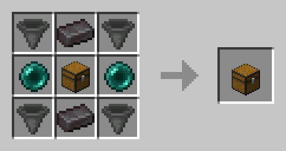

# Master SDC

**Master SDC** (Salle Des Coffres) trie tes items à ta place. Tu déposes tout dans un seul coffre, l'**Alpha**, et chaque item part automatiquement dans le coffre **Bêta** dont le filtre correspond.

```
 Items déposés  →  [ Coffre ALPHA ]  →  Bêta « Cobblestone »
                                      →  Bêta « Minerais »
                                      →  Bêta « Default » (le reste)
```

Bon à savoir
Chaque joueur a **une seule salle des coffres**. Elle peut contenir plusieurs coffres Alpha (selon ton niveau) et de nombreux coffres Bêta (selon ton niveau ou ton grade).


---

## 🚀 Démarrage rapide

1. Fabrique un **coffre Alpha** et pose-le.
2. Pose un coffre simple ou double pour ton premier **Bêta**, dans le rayon d'action de l'Alpha (250 blocs).
3. Tape `/sdc create beta <pseudo> COBBLESTONE`, puis fais un **clic droit** sur ce coffre.
4. Dépose de la cobblestone dans l'Alpha : elle part toute seule dans le Bêta.


`<pseudo>` : `[À COMPLÉTER : ton pseudo ou celui du propriétaire de la salle]`.
Les items s'écrivent avec leur **identifiant anglais en majuscules** (`COBBLESTONE`, `IRON_INGOT`, `OAK_LOG`…).


---

## 📊 Les limites

### Coffres Alpha

| Coffre Alpha | Niveau requis |
|---|---|
| 1er | 1 |
| 2e | 14 |
| 3e | 22 |
| 4e | 31 |
| 5e | 41 |
| 6e (maximum) | 50 |

### Coffres Bêta

| Joueur | VIP | Master |
|---|---|---|
| 40 coffres par niveau | 500 coffres d'emblée | 2000 coffres (maximum) |

Le rayon d'action d'un coffre Alpha est de **250 blocs**.

---

## Le coffre Alpha

Le coffre **Alpha** est le point d'entrée de ta salle des coffres : c'est celui dans lequel tu déposes les items à trier. Pour le fabriquer, utilise cette recette :




---

## Les coffres Bêta

Les coffres **Bêta** sont les coffres de sortie : c'est là que les items sont triés. Un coffre Bêta peut avoir un ou plusieurs filtres. Pose d'abord un coffre simple ou double, puis choisis une méthode :

### Avec les items dans la commande

```
/sdc create beta <pseudo> <item> 
```

Sépare les items par un espace pour mettre plusieurs filtres à la fois, puis fais un **clic droit** sur le coffre.

Exemple :

```
/sdc create beta Steve COBBLESTONE COBBLESTONE_SLAB
```

### Avec l'item en main

```
/sdc create beta <pseudo>
```

Tiens en main l'item à trier, puis fais un **clic droit** sur le coffre.

Coffre « Default »
Si tu ne tiens aucun item lors du clic, le coffre devient un coffre **Default** : il reçoit tous les items qui ne correspondent à aucun autre filtre.


### Avec le contenu du coffre

```
/sdc create beta <pseudo> @auto
```

Tous les items **déjà présents dans le coffre** deviennent ses filtres.


---

## Gérer les filtres

### Ajouter un filtre

Tu peux ajouter un filtre à un coffre Bêta qui en a déjà, de trois façons :

| Méthode | Comment faire |
|---|---|
| Avec un item | `/sdc addFilter <item>` |
| Avec l'item en main | `/sdc addFilter`, puis clic droit sur le coffre avec l'item |
| Avec le contenu du coffre | `/sdc autoFilter` ajoute tous les items du coffre aux filtres |

### Supprimer un filtre

| Commande | Effet |
|---|---|
| `/sdc removeFilter <item>` | Retire **un seul** filtre du coffre Bêta |
| `/sdc remove` | Retire **tous** les filtres du coffre Bêta `[À COMPLÉTER : le coffre redevient-il un coffre normal ?]` |

---

## Partager ta salle des coffres

Tu peux donner accès à ta salle des coffres à un autre joueur. Il pourra la modifier.

| Commande | Effet |
|---|---|
| `/sdc share add <pseudo>` | Ajoute un membre |
| `/sdc share remove <pseudo>` | Retire un membre |

---

## Retrouver les infos d'un coffre

Tape `/sdc info`, puis fais un **clic droit** sur un coffre.

| Type de coffre | Informations affichées |
|---|---|
| **Alpha** | Le propriétaire et le nom de la salle des coffres |
| **Bêta** | Son filtre, l'emplacement du coffre Alpha et le propriétaire de la salle |

Toutes ces commandes sont aussi disponibles en jeu avec `/sdc help`.

---

## ❓ Foire aux questions

- Puis-je avoir plusieurs salles des coffres ? 
Non, une seule salle des coffres est disponible par joueur. En revanche, elle peut contenir jusqu'à 6 coffres Alpha.


- Quel est le rayon d'action du coffre Alpha ? 
Un coffre Alpha trie les items jusqu'à **250 blocs** autour de lui.


- Y a-t-il une limite de coffres Bêta ? 
Oui. Tu débloques 20 coffres Bêta par niveau de joueur. Le grade VIP en donne 250 d'emblée, le grade Master 1000, qui est le maximum.


- Puis-je supprimer mon coffre Alpha ? 
Non, pas tant qu'il reste des coffres Bêta dans la même salle des coffres : supprime d'abord tous les Bêta.


- Puis-je avoir plusieurs coffres avec les mêmes filtres ? 
Oui. L'Alpha envoie les items en priorité vers le premier coffre créé. Quand celui-ci est plein, il envoie les items vers le second.


- Les items renommés sont-ils triés ? 
Oui. Le tri se fait selon l'identifiant de l'item, donc un papier renommé (à l'enclume ou via un plugin) ira quand même dans le coffre à papier.


- Que se passe-t-il quand un coffre Bêta est plein ? 
Quand un coffre Bêta est plein, le surplus est redirigé vers un coffre default.


- Puis-je utiliser des entonnoirs avec l'Alpha ? 
Oui ! Vous pouvez relier un entonnoir à un coffre alpha et les items seront bien triés automatiquement.

