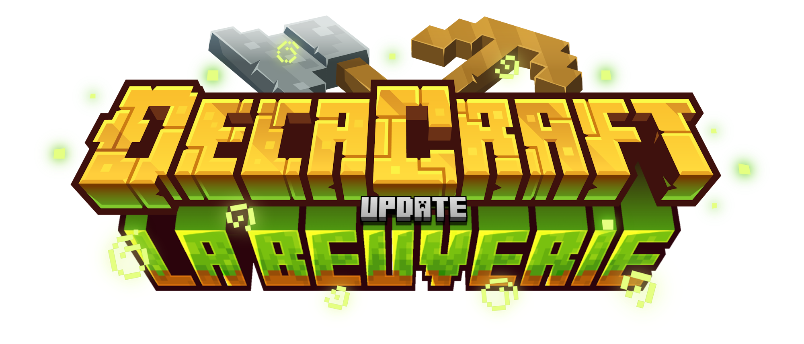
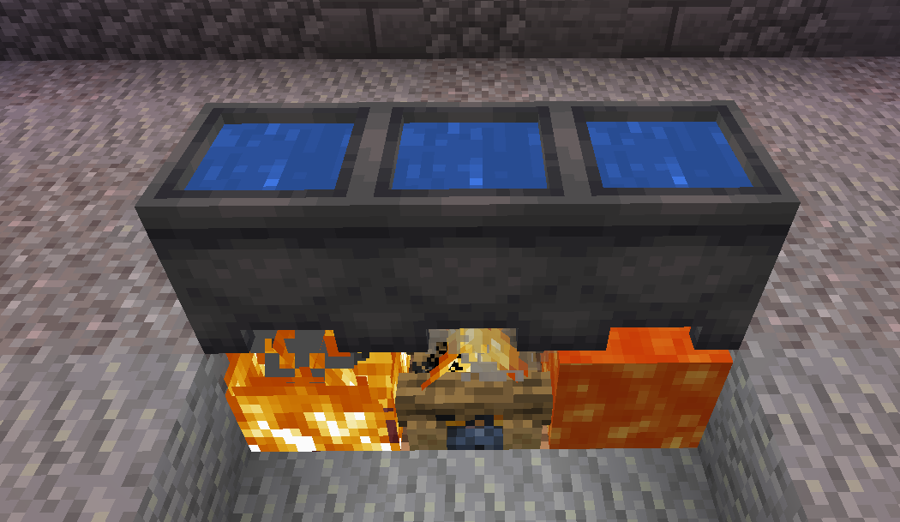
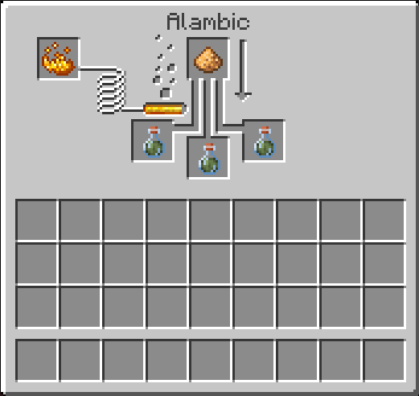
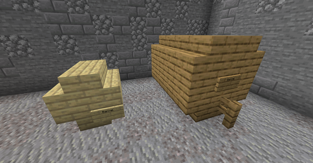
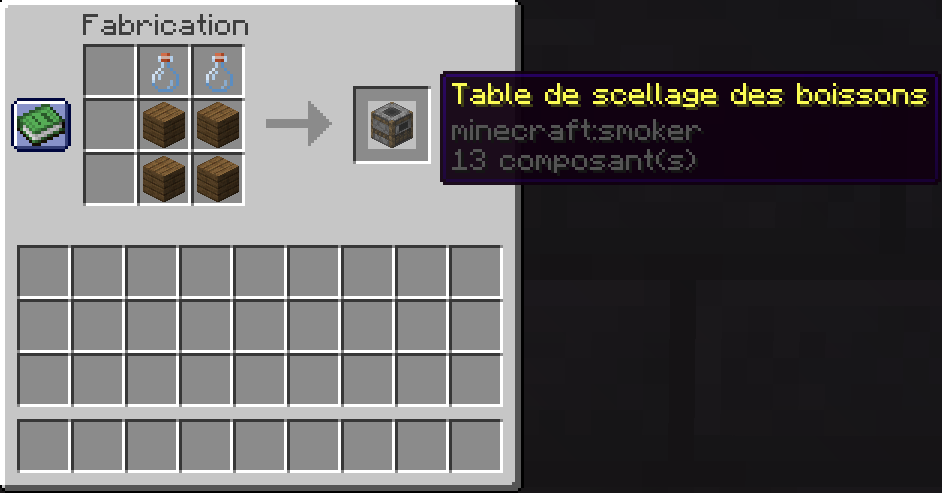

# Boisson et Alcool

Depuis la mise à jour **La Beuverie**, tu peux fabriquer des boissons et de l’alcool sur DecaCraft. Une série de [succès](#comment-débloquer-les-recettes-) est liée à la création de boissons.

## En résumé

Chaque boisson se fabrique en **4 étapes**, puis peut être vendue :

| Étape | Où ? | Durée |
|---|---|---|
| 1. [Cuisson](https://wiki.decacraft.net/alcool/#1-la-cuisson) | Chaudron sur une source de chaleur | Selon la recette (temps réel) |
| 2. [Distillation](https://wiki.decacraft.net/alcool/#2-la-distillation) | Alambic | Selon la recette |
| 3. [Fermentation](https://wiki.decacraft.net/alcool/#3-la-fermentation) | Tonneau en bois | 1 jour Minecraft = 20 min réelles |
| 4. [Scellage](https://wiki.decacraft.net/alcool/#4-le-scellage) | Table de scellage | Instantané |
| 5. [Vente](https://wiki.decacraft.net/alcool/#5-la-vente) | PNJ Amaury (taverne du spawn) | Instantané |

> **⏱️ Le temps est réel.** Il continue de s’écouler même si tu es déconnecté ou si la zone n’est pas chargée. Dormir n’accélère rien.

## Les recettes

Un **livre de recettes** t’est donné par le PNJ **Rodolphe**, dans la taverne du spawn. Toutes les recettes y sont visibles. Ce livre t’appartient : toi seul peux l’ouvrir.

Tu obtiens de nouvelles recettes en complétant les **succès** liés à la création de boissons (voir la [FAQ](https://wiki.decacraft.net/alcool/#foire-aux-questions)).

## 1. La cuisson

1. Place un **chaudron rempli d’eau** sous une **source de chaleur** (feu, lave ou feu de camp).
2. Ajoute les ingrédients : tiens-les en main et fais un **clic droit** sur le chaudron. L’ingrédient disparaît et des particules apparaissent au-dessus.
3. **Laisse cuire** le temps indiqué dans la recette.
4. Récupère ton mélange avec des **bouteilles en verre**.

> **💡 Astuce :** la durée de cuisson compte pour la qualité de la boisson. Fais un clic droit sur le chaudron avec une **montre** pour connaître le temps d’ébullition.

## 2. La distillation

La distillation est une étape clé du processus. Place les bouteilles issues de la cuisson dans un **alambic**, puis ajoute :

| Compartiment | Objet à y placer |
|---|---|
| Carburant | Une **poudre de blaze** |
| Ingrédients | Une **poudre lumineuse** |

> Ces deux objets ne sont **pas consommés**.

## 3. La fermentation

Une fois la distillation terminée, la boisson doit **vieillir** pour développer ses arômes. Place-la dans un **tonneau en bois**.

### Les deux types de tonneaux

| Tonneau | Capacité | Construction |
|---|---|---|
| **Petit tonneau** | 9 emplacements | 8 escaliers du même bois + une pancarte écrite « barrel » |
| **Grand tonneau** | 27 emplacements | 16 escaliers, 20 planches et 1 barrière du même bois + une pancarte écrite « barrel » |

- Place la **pancarte en dernier**.
- Le bois doit être **du même type** pour toute la construction. Certaines recettes demandent un bois précis.
- Le **baril Minecraft** fait office de tonneau en chêne.

## 4. Le scellage

Le scellage marque la **fin de la fabrication** : il stabilise la boisson pour qu’elle n’évolue plus dans le temps.

- Insère tes boissons dans la **table de scellage**.
- Un son distinctif et l’affichage de la **qualité** de la boisson confirment le scellage.
- Le craft de la table de scellage se trouve dans les recettes Minecraft.

Une fois scellée, la boisson devient un **produit fini**, prêt à être consommé ou vendu.

## 5. La vente

Tu peux vendre tes boissons contre des **Ð** auprès du PNJ **Amaury**, dans la taverne du spawn.

> **⚠️ Attention :** Amaury n’achète que les boissons de **qualité parfaite**, symbolisées par **[★★★★★]**.

## Foire aux questions

### Comment débloquer les recettes ?

Pour débloquer une nouvelle recette, il faut atteindre le **palier 5** dans une boisson. La recette est donnée automatiquement dans le `/reward`. Tu peux voir les boissons débloquées dans le `/succes`.

### Comment valider les paliers de succès ?

Deux étapes :

1. La boisson doit être notée **5 étoiles**. Pour cela, respecte exactement la recette : n’oublie ni n’ajoute aucun ingrédient, et ne dépasse pas le temps de cuisson.
2. La boisson doit ensuite être **scellée** : c’est cette action qui valide le palier.

### Le temps passe-t-il quand la zone n’est pas chargée ?

Oui. Le temps continue de s’écouler même quand la zone est déchargée :

- les boissons dans les chaudrons continuent de cuire ;
- les boissons dans les tonneaux continuent de vieillir.

### Dormir accélère-t-il le processus ?

Non. Le temps est basé sur le **temps réel** :

| Où ? | Équivalence |
|---|---|
| Chaudron | 1 minute réelle = 1 minute de cuisson |
| Tonneau | 1 jour Minecraft = 20 minutes réelles |

### Les ressources de l’alambic sont-elles consommées ?

Non. Il faut une poudre de blaze et une poudre lumineuse pour faire fonctionner l’alambic, mais ces deux ressources ne sont pas consommées.

### Peut-on vendre toutes les boissons à Amaury ?

Non. Seules les boissons **parfaites** (5 étoiles **et** scellées) peuvent être vendues au PNJ Amaury.

### Plusieurs joueurs peuvent-ils utiliser le même tonneau ?

Oui. Un tonneau est partagé et accessible à tous les joueurs **tant qu’il n’est pas protégé** (voir [Les Protections](https://wiki.decacraft.net/bolt/)). Tu peux donc vieillir tes boissons dans le même tonneau qu’un autre joueur.

### Une boisson continue-t-elle de vieillir après le temps recommandé ?

Oui. En revanche, sa **qualité peut diminuer** si elle reste trop longtemps dans le tonneau.

### Que se passe-t-il si je me trompe dans une recette ?

La boisson sera de **mauvaise qualité** (moins d’étoiles) et pourra donner des **effets négatifs**. Elle ne comptera pas pour débloquer les paliers.

## Pages liées

- [L’économie](https://wiki.decacraft.net/economy/) : à quoi servent les Ð gagnés
- [Les Protections](https://wiki.decacraft.net/bolt/) : protéger ton tonneau
