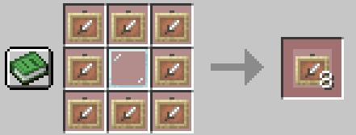
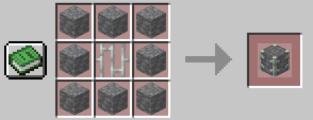
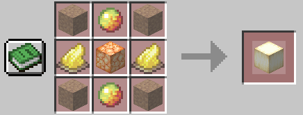
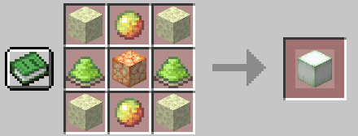
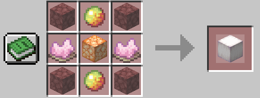
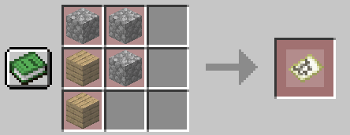
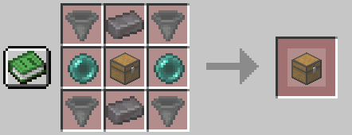
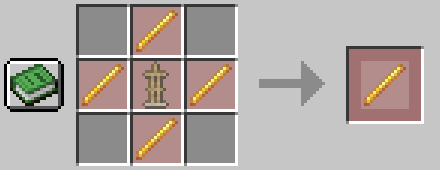

# Liste des recettes personnalisées

DecaCraft propose des **recettes de craft exclusives**, absentes du Minecraft classique. Les voici toutes, avec leur utilité.

## En résumé

| Item | À quoi ça sert |
|---|---|
| [Cadre invisible](#cadre-invisible) | Un cadre dont le support est invisible |
| [Ardoise des abîmes renforcée](#ardoise-des-abîmes-renforcée) | Permet d'avoir ce bloc normalement pas disponible en mode survie |
| [Les Grelampes](#les-grelampes) | Permet d'avoir ces blocs, puisqu'il n'est pas possible de crée de portail du nether |
| [Carte indestructible](#carte-indestructible) | Eastereggs |
| [Coffre Alpha](#coffre-alpha) | Le point d'entrée du tri automatique [Master SDC](/mastersdc/) |
| [Éditeur de porte-armures](#éditeur-de-porte-armures) | Modifier les porte-armures avec [EasyArmorStand](/easyarmorstand/) |

## Cadre invisible

Il fonctionne exactement comme un cadre, sauf que celui-ci est **invisible**.

## Ardoise des abîmes renforcée

## Les Grelampes

Il existe trois couleurs, chacune avec sa recette :

**Grelampe jaune**

**Grelampe verte**

**Grelampe rose**

## Carte indestructible

## Coffre Alpha

Le coffre Alpha sert au tri automatique des coffres. Tout est expliqué sur la page [Master SDC](/mastersdc/).

## Éditeur de porte-armures

Cet outil sert à modifier les porte-armures. Tout est expliqué sur la page [Les porte-armures personnalisés](/easyarmorstand/).

## Pages liées

- [Master SDC](/mastersdc/) : le tri automatique de tes coffres
- [Les porte-armures personnalisés](/easyarmorstand/) : poser et personnaliser ses porte-armures
