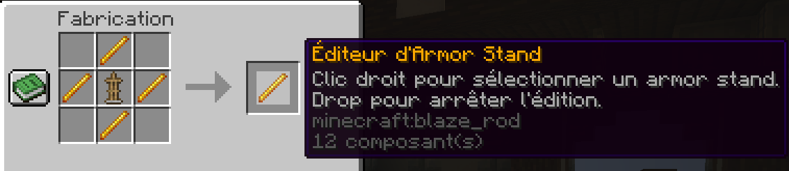
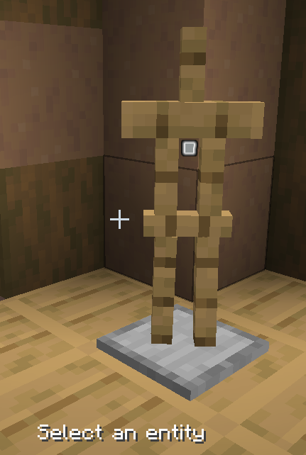
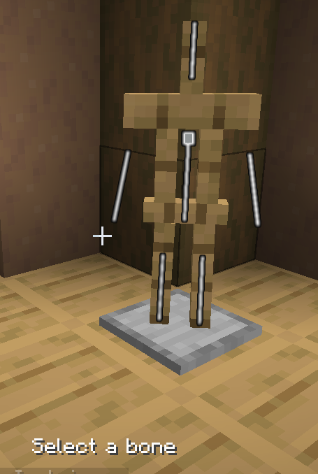
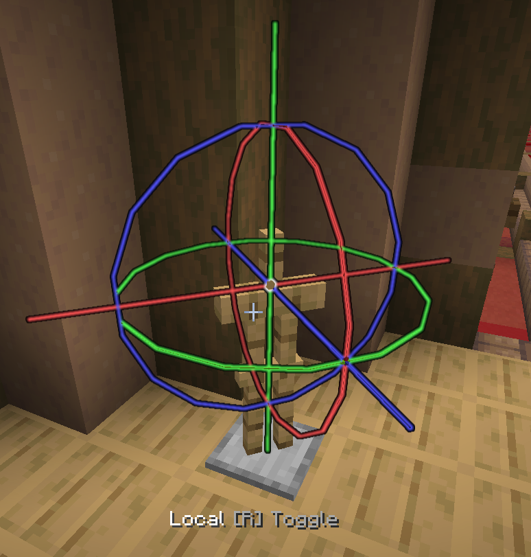
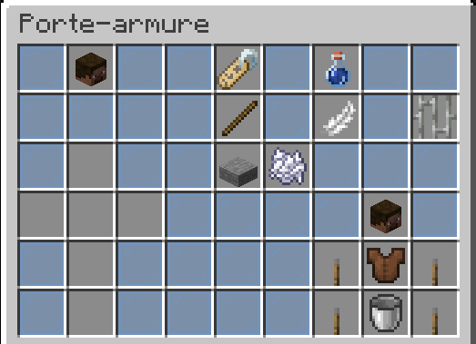
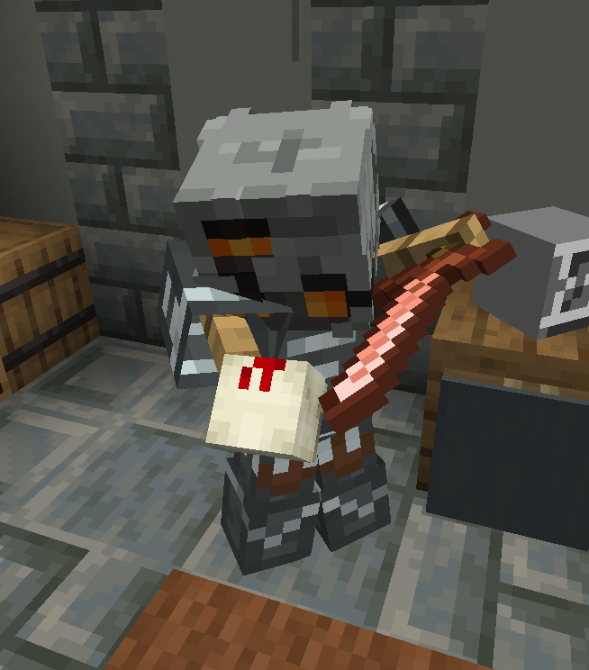
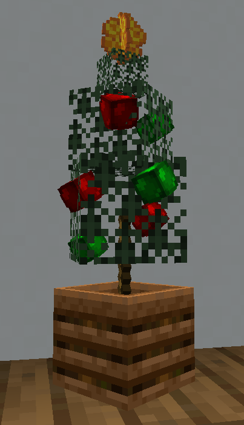

# Les porte-armures personnalisés

Le plugin **EasyArmorStand** (EAS) permet de modifier facilement les porte-armures dans Minecraft **sans utiliser de commandes**. Tout se fait avec un outil spécial : le **Bâton Éditeur**.

## Fabriquer le Bâton Éditeur

Le Bâton Éditeur se fabrique à la table de craft :

## Utiliser le Bâton Éditeur

Tiens ton Bâton Éditeur en main, puis suis ces étapes.

### 1. Sélectionner le porte-armure

Fais un **clic droit** sur le petit carré lumineux pour sélectionner le porte-armure.

### 2. Choisir une partie à modifier

Une fois le porte-armure sélectionné, des **barres virtuelles** apparaissent au niveau :

- des bras
- des jambes
- de la tête
- du corps
- du petit carré lumineux au milieu du porte-armure

Pour choisir une partie, vise l'une de ces barres avec ton curseur et fais un **clic droit**.

### 3. Déplacer le porte-armure

De nouvelles barres apparaissent : ce sont les **axes**. Vise l'une d'elles et fais un **clic droit**, puis **bouge ton curseur** pour déplacer la partie.

| Action | Effet |
|---|---|
| Clic droit | Valide la position |
| Clic gauche | Annule le déplacement |
| Clic droit sur le carré lumineux central | Déplace le porte-armure **en entier** |

> **💡 Astuce :** accroupis-toi pour un déplacement plus précis.

## Les options du porte-armure

Dans l'interface virtuelle, fais un **clic gauche** sur le petit carré lumineux pour ouvrir les options. Tu peux :

| Option | Effet |
|---|---|
| Mettre un nom | Donne un nom au porte-armure (couleurs possibles, voir ci-dessous) |
| Rendre invisible | Cache le porte-armure |
| Ajouter des bras | Ajoute des bras au porte-armure |
| Désactiver la gravité | Le porte-armure flotte |
| Verrouiller l'équipement | Les équipements ne peuvent être retirés que via l'éditeur |
| Enlever la base | Supprime la base du porte-armure |
| Réduire la taille | Rend le porte-armure plus petit |

### Mettre des couleurs dans un nom

Entoure le nom de la couleur avec `<` et `>`. Couleurs disponibles :

| | | | |
|---|---|---|---|
| `black` | `dark_blue` | `dark_green` | `dark_aqua` |
| `dark_red` | `dark_purple` | `gold` | `gray` |
| `dark_gray` | `blue` | `green` | `aqua` |
| `red` | `light_purple` | `yellow` | `white` |

Tu peux aussi utiliser une **couleur hexadécimale** en ajoutant un `#` avant le code.

Exemple : `<#FF7676>Bonjour !`

> **⚠️ Le nom n'apparaît pas ?** Sélectionne le porte-armure, puis tape la commande `/eas name visible true`.

## Idées de décoration

Voici quelques exemples simples de ce qu'on peut créer avec cet outil :

## Pages liées

- [Les Protections](/bolt/) : les porte-armures peuvent être protégés avec `/lock`
- [Monde Créatif](/creative/) : un endroit idéal pour s'entraîner
