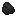
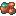
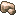
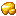
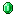
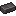

# L'économie

Un système d'économie est en place sur le serveur : il te permet de **montrer ta puissance** ! Tu peux utiliser ton argent pour acheter divers items dans le [market](#le-market) ou ailleurs.

Il existe plusieurs moyens de se faire de l'argent, à toi de les découvrir... La monnaie du serveur est le **Ð**.

## Les commandes

| Commande | Effet |
|---|---|
| `/money` | Voir ton solde actuel |
| `/baltop` | Voir le classement des joueurs les plus riches |
| `/sell hand` | Vendre ce que tu as dans la main |
| `/sell inventory` | Vendre tout ce qui est vendable dans ton inventaire |
| `/pay [joueur] [montant]` | Donner de l'argent à un autre joueur |

## Le codex

Une des principales façons de gagner de l'argent est de **vendre des minerais**. Voici la liste des prix de vente.

| Item | Prix de vente | Prix du bloc (×9) |
|---|---:|---:|
|  Charbon | 4 Ð | 36 Ð |
|  Redstone | 3 Ð | 27 Ð |
|  Lapis-lazuli | 5 Ð | 45 Ð |
|  Cuivre brut | 4 Ð | 36 Ð |
|  Lingot de cuivre | 2 Ð | 18 Ð |
|  Fer brut | 7 Ð | 63 Ð |
|  Lingot de fer | 3 Ð | 27 Ð |
|  Or brut | 25 Ð | 225 Ð |
|  Lingot d'or | 5 Ð | 45 Ð |
|  Émeraude | 15 Ð | 135 Ð |
|  Diamant | 120 Ð | 1 080 Ð |
|  Lingot de netherite | 1 000 Ð | 9 000 Ð |

Les **blocs** liés à ces minerais sont également vendables : il suffit de multiplier le prix par 9 pour obtenir celui du bloc.

> **💡 Astuce :** le cuivre, le fer et l'or **bruts** se vendent plus cher que les lingots. Inutile de les fondre avant de vendre.

## Le market

Pour commercer avec les autres joueurs, un **market** est disponible. Tu peux y vendre n'importe quel item.

| Commande | Effet |
|---|---|
| `/market` | Ouvre le market |
| `/market add [prix]` | Met en vente l'item que tu as en main |

### Nombre de places

> **⚠️ Attention :** les places sont limitées, et leur nombre dépend de ton grade.

| Grade | Places au market |
|---|:---:|
| Joueur | 10 |
| VIP | 15 |
| Master | 20 |

## Autres façons de gagner de l'argent

D'autres méthodes sont disponibles :

- **L'alcool** : découvre comment brasser et vendre des boissons sur la page [Boisson et Alcool](/alcool/).

## Pages liées

- [Boisson et Alcool](/alcool/) : fabriquer et vendre des boissons
- [Les Grades](/grades/) : les places du market selon ton grade
- [Règlement](/rules/#article-9--léconomie) : les règles sur l'économie
