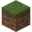
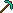
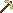

# Les Mondes

Le serveur propose **plusieurs mondes**, chacun avec son utilité. Respecte bien le rôle de chacun : on construit dans certains, on récolte dans d'autres.

> **💡 Astuce :** tu peux repérer dans quel monde se trouve un joueur (ou toi-même) grâce à l'**icône placée devant son pseudo**, dans le tab ou dans le tchat.

## Vue d'ensemble

| Type de monde | Construire | Récolter | Réinitialisé |
|---|:---:|:---:|:---:|
| [Construction](#les-mondes-de-construction) | ✅ | ❌ | ❌ |
| [Ressources](#les-mondes-de-ressources) | ❌ | ✅ | ✅ |
| [Créatif](#le-monde-créatif) | ✅ (ta parcelle) | ❌ | ❌ |

## Les mondes de construction

Dans ces mondes, tu peux laisser libre cours à ton imagination et construire ce que tu veux... dans la limite du [règlement](https://wiki.decacraft.net/rules/), bien entendu !

| Icône | Monde |
|:---:|---|
|  | Le monde **Principal** |
|  | Le monde **Nether** |
|  | Le monde **End** |

> **⚠️ À savoir :** merci de **ne pas récolter de ressources** dans ces mondes, afin de préserver le paysage. Pour cela, utilise les mondes de ressources ci-dessous.

## Les mondes de ressources

Dans ces mondes, tu peux **tout piller, tout détruire**. En revanche, **ne construis rien** : ils peuvent être réinitialisés, et les pertes ne sont pas remboursées.

| Icône | Monde |
|:---:|---|
|  | Le monde **Ressources** |
|  | Le monde **Ressources Nether** |
|  | Le monde **Ressources End** |

## Le monde Créatif

Le monde Créatif te donne une parcelle personnelle pour construire en mode créatif. Tout est expliqué sur la page [Monde Créatif](https://wiki.decacraft.net/creative/).

## Se déplacer entre les mondes

> Le déplacement vers les mondes ressources se fait au /spawn via les portails situés sur la droite.

## Informations pratiques

| | Monde de construction | Monde de ressources |
|---|---|---|
| **Taille de la map** | 30 000 x 30 000 | 15 000 x 15 000 |
| **Fréquence de réinitialisation** | Jamais | à chaque mise à jour |

## Pages liées

- [Règlement](https://wiki.decacraft.net/rules/) : les règles sur les ressources, les constructions et le PVP
- [Monde Créatif](https://wiki.decacraft.net/creative/) : ta parcelle personnelle
- [L'économie](https://wiki.decacraft.net/economy/) : vendre ce que tu récoltes
